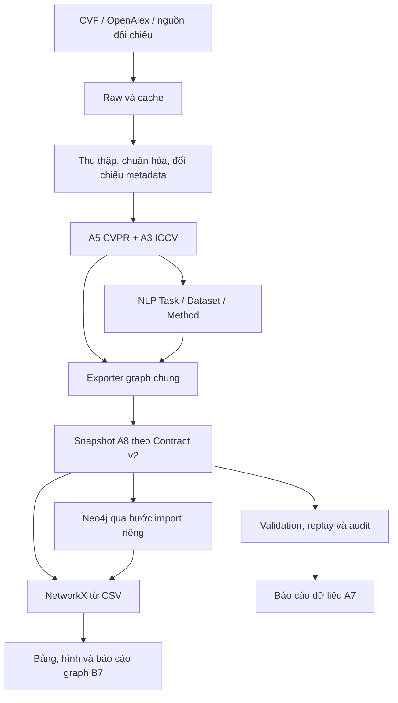

# Mạng lưới tác giả và tổ chức nghiên cứu về Computer Vision

Dự án xây dựng mạng học thuật chung từ **350 bài CVPR 2024 và 350 bài ICCV 2023**, kết nối công trình, tác giả, tổ chức, quốc gia, bài toán, phương pháp và bộ dữ liệu. Công nghệ sử dụng: **Python, spaCy, Neo4j và NetworkX**.
- Sinh viên A: Đinh Tiến Hùng
- Sinh viên B: Nông Sơn Tùng

## 1. Giới thiệu

Mục tiêu là khảo sát đồng tác giả, hợp tác giữa tổ chức, trích dẫn và chủ đề nghiên cứu trong mẫu 700 bài thuộc **main conference**, không lấy workshop. A phụ trách CVPR, thu thập/làm sạch và NLP Task–Dataset; B phụ trách ICCV, Neo4j, Method và phân tích mạng.

CVF Open Access cung cấp bản conference, byline và abstract. OpenAlex bổ sung định danh, affiliation theo bài và danh sách tham khảo. arXiv và Crossref được dùng chọn lọc để đối chiếu metadata; preprint không được tính thêm thành Paper core.

**Hiện trạng:** main đã có snapshot tích hợp A8, kết quả phân tích B6 và bản nháp báo cáo B7. Dữ liệu đủ phạm vi core; audit và báo cáo nhóm cuối chưa hoàn tất.

| Chỉ tiêu | Snapshot A8 |
| --- | ---: |
| Paper core CVPR 2024 / ICCV 2023 | 350 / 350 |
| Paper reference đã nhập | 0 |
| Tổng node / cạnh duy nhất | 4.182 / 16.979 |
| Author / Institution duy nhất | 2.950 / 432 |
| Task / Method / Dataset có cạnh accepted | 14 / 28 / 14 |
| STUDIES_TASK / USES_METHOD / EVALUATED_ON | 97 / 195 / 28 |

Nguồn: [manifest graph A8](data/processed/mxh_cv_700/a8/graph/snapshot_manifest.json), snapshot `ffcb00e17337…`. Tổng nhóm lấy từ ID đã hợp nhất, không cộng trực tiếp số Author/Institution của hai corpus. Số cạnh là số khóa cạnh duy nhất, không phải tổng trọng số.

## 2. Tính năng chính

- **Thu thập và replay từ cache:** lưu raw, hash, thời điểm và trạng thái nguồn; có timeout, retry/backoff và chế độ offline.
- **Chuẩn hóa, định danh:** giữ thứ tự tác giả conference, đối chiếu DOI/Work ID/arXiv, resolve Author/Institution có chứng cứ; trường hợp mơ hồ giữ null và đưa vào review.
- **NLP có bằng chứng:** spaCy PhraseMatcher/Matcher trích Task, Dataset và Method từ title/abstract. Cấu hình hiện tại dùng tokenizer tiếng Anh `blank` và sentencizer, không cần tải mô hình hoặc gọi LLM. Evidence giữ câu nguyên văn, phiên bản text, rule và offset Unicode `[start,end)`.
- **Graph theo Contract v2:** 8 nhãn node gồm Author, Paper, Institution, VenueEdition, Task, Method, Dataset, Country và 10 quan hệ dưới đây.
- **Phân tích NetworkX:** degree/strength, thành phần liên thông, Louvain, PageRank, hợp tác tổ chức/quốc gia, thống kê NLP và case study; xuất CSV, hình và truy vấn Cypher.
- **Audit và bàn giao:** validation schema/hash/khóa/evidence, replay xác định, phiếu chấm/đọc chéo và biên nhận theo snapshot.

| Nhóm | Quan hệ |
| --- | --- |
| Metadata | AUTHORED, AFFILIATED_WITH, PUBLISHED_IN, CITES, BASED_IN |
| Dẫn xuất | COAUTHORED_WITH, COLLABORATED_WITH |
| NLP | STUDIES_TASK, USES_METHOD, EVALUATED_ON |

Cạnh cộng tác vô hướng lưu một lần với `src < dst`; trọng số đếm Paper core khác nhau hỗ trợ cặp đó. Một tác giả có hai affiliation không tự tạo cạnh hợp tác giữa hai tổ chức. CITES hiện chỉ nối các Paper core đã resolve.

## 3. Kiến trúc tổng thể



A8 tái sử dụng collector, cleaner, NLP và exporter có sẵn. Lệnh tích hợp mặc định không import/xóa DB. Metadata/NLP trung gian có `graph_ready=false`; snapshot đầy đủ đã qua Contract mới có `graph_ready=true`. Cờ này không chứng nhận độ chính xác ngữ nghĩa hay nghiệm thu đồ án.

Tham khảo [Data Contract v2](handoff/mxh_contract_v2/docs/DATA_CONTRACT.md) và [Field Index](handoff/mxh_contract_v2/docs/FIELD_INDEX.md) để hiểu ID, null, provenance và evidence. Đọc đường dẫn bảng từ manifest; không mặc định mọi bảng nằm cạnh manifest.

## 4. Cài đặt

Cần Git và **Python 3.12**. Các ví dụ dùng PowerShell trên Windows, chạy từ thư mục gốc repository. Raw/cache và snapshot đi kèm phục vụ replay offline; server Neo4j không được cài tự động khi clone.

```powershell
git clone https://github.com/Sntug/FinalTerm.git
Set-Location FinalTerm

# Môi trường tích hợp và báo cáo A7/A8
py -3.12 -m venv .venv-a4
$aPython = ".\.venv-a4\Scripts\python.exe"
& $aPython -m pip install -r config/requirements_a7.txt

# Môi trường phân tích B6 và Neo4j driver
py -3.12 -m venv .venv
$bPython = ".\.venv\Scripts\python.exe"
& $bPython -m pip install -r config/requirements_b6.txt
```

**Dùng hai môi trường riêng:** A7/A8 khóa spaCy 3.8.18 và Matplotlib 3.10.7; B6 khóa NetworkX, SciPy, NumPy, Neo4j driver và Matplotlib 3.9.2. Cài chung hai bộ requirements sẽ xung đột phiên bản Matplotlib. Không cần activate venv nếu gọi trực tiếp interpreter; mở terminal mới thì khai báo lại `$aPython` và `$bPython`.

## 5. Chạy dự án

Có thể mở ngay [báo cáo A7](report/a7_data_preprocessing_nlp.md), [báo cáo graph B7](report/b7_graph_analysis.md) và [metrics B6](outputs/b6/metrics.json) mà không cần chạy lại pipeline.

### 5.1. Tích hợp và kiểm tra offline

```powershell
$aPython = ".\.venv-a4\Scripts\python.exe"
& $aPython -B -X utf8 -m src.integration.a8 run
```

Lệnh kiểm tra nguồn A/B, replay làm sạch/A5, chạy NLP/export graph, validation, audit, cập nhật A7 và chạy tests offline. Nếu có driver/kết nối, nó còn thử đối chiếu DB bằng truy vấn đọc; các live test tự ghi DB của B bị vô hiệu hóa trong lượt regression này.

| Đầu ra | Nội dung |
| --- | --- |
| `data/processed/mxh_cv_700/a8/nlp/` | Node/cạnh NLP, evidence, review và manifest trung gian |
| `data/processed/mxh_cv_700/a8/graph/` | 12 bảng Contract v2 và manifest graph chung |
| `outputs/a8/integration_manifest.json` | Snapshot, commit nền lúc chạy, hash code/config và trạng thái bàn giao |
| `outputs/a8/validation_summary.json` | Kết quả từng check, lệnh và minh chứng |
| `outputs/a8/audit/` | Phiếu cạnh/node và tổng hợp audit đúng snapshot A8 |
| `outputs/a7/` và `report/a7_data_preprocessing_nlp.md` | Số liệu, hình và báo cáo dữ liệu cập nhật |

Snapshot là bất biến: chạy lại cùng input phải giữ nguyên bytes; đổi input/rule cần output mới và config đồng bộ. Runner giữ phiếu đã điền, chỉ tổng hợp lại phần dẫn xuất. Đọc từng trạng thái PASS/FAIL/PENDING_B/BLOCKED_ENV/NOT_RUN; hoàn thành lượt kiểm tra offline không đồng nghĩa đồ án đã final.

**Sau khi đồng bộ B6/B7:** biên nhận A8 và bảng A7 lưu lần chạy trước có thể chưa phản ánh phiếu mới/phần B vừa bổ sung. Config kiểm kê A8 còn mô tả dependency cũ; file B xuất hiện chưa tự được công nhận PASS. Đối chiếu báo cáo B7, metrics B6 và phiếu hiện tại rồi cập nhật/tái kiểm chứng khi chốt bàn giao.

### 5.2. Phân tích NetworkX

Từ CSV, không cần Neo4j:

```powershell
$bPython = ".\.venv\Scripts\python.exe"
& $bPython -B -X utf8 -m src.analysis --source csv --out outputs/b6_local
```

Đầu vào được khóa tại `src/analysis/load.py` tới graph A8. Output gồm `metrics.json`, `tables/`, `figures/`, `case_study/`; thêm `--no-figures` nếu chỉ cần số liệu/bảng. Dùng output riêng như ví dụ để giữ kết quả đã bàn giao trong `outputs/b6/`.

Khi DB chứa đúng snapshot và đã cấu hình `.env`:

```powershell
& $bPython -B -X utf8 -m src.analysis --source neo4j --out outputs/b6_neo4j_local
```

Nhánh Neo4j đối chiếu snapshot tag, content hash và counts với CSV trước khi phân tích, đồng thời chạy demo B6 trong `queries/`. Các file `.cypher` cũng có thể mở bằng Neo4j Browser.

### 5.3. Audit và báo cáo

Điền phiếu cạnh/node tại `outputs/a8/audit/` theo [hướng dẫn audit](outputs/a8/audit/a6_review_summary.md). Chỉ sửa các cột review được phép; giữ ID, assignment, membership và evidence.

```powershell
& $aPython -B -X utf8 -m src.audit summarize --config config/a8_audit.json
& $aPython -B -X utf8 -m src.reporting.a7 --config config/a7_report.json
```

A7 tạo lại bảng có marker, metrics và hai hình PNG/SVG, giữ văn bản ngoài marker. `pending_review` không nằm trong mẫu số đã chấm; `unverifiable` được tính là chưa đúng. Không suy độ chính xác toàn graph từ một phần mẫu hoặc từ checks kỹ thuật.

### 5.4. Validation và tests riêng

```powershell
& $aPython -B -X utf8 -m src.clean.verify --config config/a_cvpr2024_a3.json
& $aPython -B -X utf8 -m src.clean.verify --config config/b_iccv2023_a3.json
& $aPython -B -X utf8 -m src.metadata.verify --config config/a_cvpr2024_a5.json
& $aPython -B -X utf8 -m src.nlp.verify --config config/a8_nlp_700.json --graph-manifest data/processed/mxh_cv_700/a8/graph/snapshot_manifest.json
& $aPython -B -X utf8 -m unittest discover -s quality/checks -p 'test_*.py' -v
& $bPython -B -X utf8 -m unittest src.analysis.test_analysis -v
```

Biên nhận A8 trước đợt B6/B7 ghi 170 test quality và 10 test B qua, 3 test Neo4j live skip; đó là kết quả lần chạy được lưu, không phải tuyên bố đã chạy lại toàn bộ trên main hiện tại. Tests analysis kiểm tra counts, tính xác định và tổng phân bổ trích dẫn giữa nhóm.

Thu thập mới hoặc chạy riêng từng giai đoạn: xem [bàn giao A2](handoff/a/A2_HANDOFF.md), [bàn giao A3](handoff/a/A3_HANDOFF.md) và [bàn giao A8](report/a8_handoff.md). Các gói A1/v2 trong `handoff/` là tài liệu/fixture lịch sử, không thay hướng dẫn CLI hiện hành.

## 6. Cấu hình môi trường và Neo4j

Tạo `.env` cục bộ nếu chưa có, không ghi đè cấu hình đang sử dụng:

```powershell
if (!(Test-Path -LiteralPath .env)) {
    Copy-Item -LiteralPath .env.example -Destination .env
}
```

| Biến | Vai trò |
| --- | --- |
| `OPENALEX_API_KEY` | Xác thực khi gọi OpenAlex; replay từ cache không cần gọi API |
| `NEO4J_URI` | URI Bolt cần đọc/import; mẫu `.env.example` là `bolt://localhost:7687` |
| `NEO4J_USER` | Tài khoản Neo4j, mẫu là `neo4j` |
| `NEO4J_PASSWORD` | Mật khẩu cục bộ do người vận hành cấu hình |

URI phải khớp server thực tế. Môi trường B từng dùng Bolt port `17687`, khác port trong `.env.example`; server và thư mục `.neo4j-pilot/` không được cung cấp qua Git. Không commit `.env`, token hay mật khẩu. Các biến môi trường Neo4j trong terminal được ưu tiên so với `.env`.

Kiểm tra DB **chỉ đọc**, dùng môi trường có driver:

```powershell
& $bPython -B -X utf8 -m src.integration.a8 neo4j-check
```

Repo có [biên nhận import của B](outputs/b_iccv2023/graph/last_import.json) và metrics B6 ghi `neo4j_vs_csv=identical` cho snapshot A8. Đây là kết quả đã lưu từ môi trường B, không chứng minh server hiện đang chạy hoặc máy mới clone đã có DB.

Importer B thay toàn bộ phạm vi `project_id` trong một transaction. Chỉ thử import trên **instance test riêng và rỗng**: cấu hình `A8_NEO4J_TEST_URI`, `A8_NEO4J_TEST_USER`, `A8_NEO4J_TEST_PASSWORD` trong môi trường cục bộ, rồi chạy:

```powershell
& $bPython -B -X utf8 -m src.integration.a8 test-import
```

Helper không dùng `.env` cho credential test, từ chối DB có dữ liệu, URI chứa credential và port `7687`/`17687`; nó gọi loader B để thử nhập lặp/rollback và giữ dữ liệu test sau khi chạy. Thiếu driver/kết nối/cấu hình ghi BLOCKED_ENV, không tính là import thành công. Chi tiết: [exporter/loader B3](src/graph/B3_README.md); [pilot B](src/graph/B_PILOT.md) mô tả môi trường lịch sử.

## 7. Cấu trúc thư mục

```text
FinalTerm/
├── config/             # Cấu hình, từ điển NLP, requirements, Contract v2
├── data/
│   ├── raw/            # Phản hồi nguồn và cache theo corpus
│   └── processed/      # Snapshot collector, clean, metadata, NLP và graph
├── src/
│   ├── collect/        # Collector chung CVF/OpenAlex và cache
│   ├── collect_b/      # Chọn dữ liệu ICCV của B
│   ├── clean/          # Chuẩn hóa, authorships và định danh
│   ├── metadata/       # Đối chiếu metadata/nguồn A5
│   ├── nlp/            # Luật Task, Dataset, Method và adapter exporter
│   ├── graph/          # Export graph và loader Neo4j
│   ├── analysis/       # NetworkX, bảng, hình và case study B6
│   ├── audit/          # Kiểm tra chất lượng, lấy mẫu và tổng hợp phiếu
│   ├── reporting/      # Số liệu và báo cáo A7
│   └── integration/    # Điều phối kiểm chứng/bàn giao A8
├── quality/            # Tests và fixtures
├── queries/            # Truy vấn Cypher đếm/thống kê/demo
├── outputs/            # Metrics, bảng, hình, audit và biên nhận thực thi
├── report/             # Nội dung A7, B7 và bàn giao A8
└── handoff/            # Kế hoạch nhóm, tài liệu bàn giao và gói lịch sử
```

