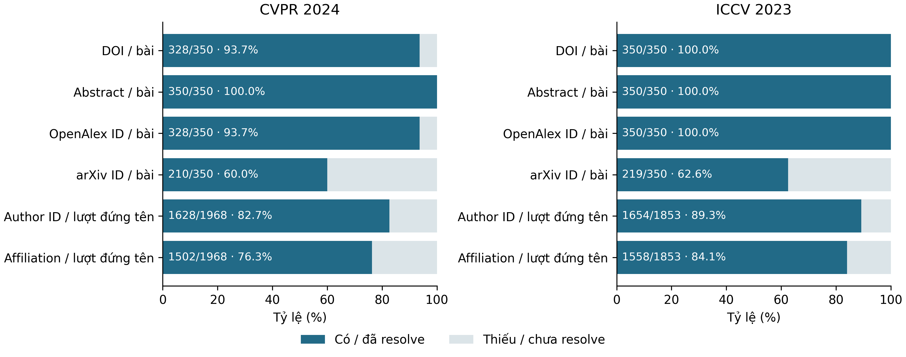
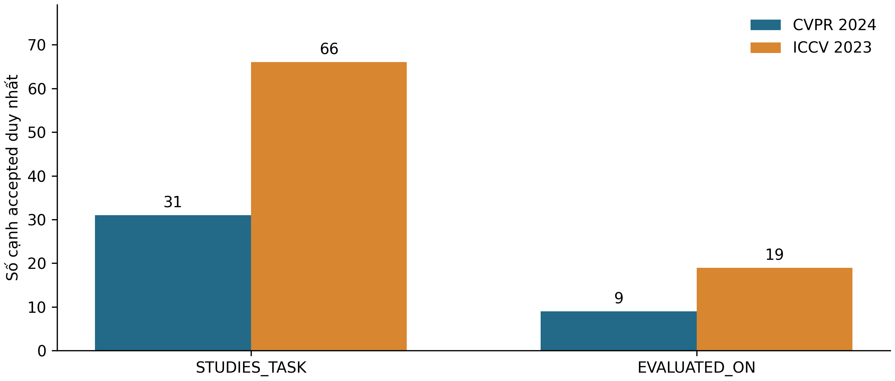

# A7 — Nguồn dữ liệu, tiền xử lý và trích xuất Task/Dataset

*Phần đóng góp của A cho báo cáo nhóm “Mạng lưới tác giả và tổ chức nghiên cứu về Computer Vision”. Phạm vi là các snapshot đã có trong repository; số liệu do `src.reporting.a7` tính lại, không thu thập thêm bài. Bảng và hình mô tả dữ liệu quan sát được, tách khỏi đánh giá ngữ nghĩa của con người. Các khối `A7:*` được script cập nhật; phần văn bản bên ngoài được giữ nguyên.*

## 1. Nguồn và phạm vi nghiên cứu

Nghiên cứu xây dựng mạng liên kết công trình, tác giả và tổ chức nhằm khảo sát hoạt động nghiên cứu thị giác máy tính trong hai kỳ hội nghị CVPR 2024 và ICCV 2023. Việc chọn hai kỳ khác nhau tạo ranh giới thu thập rõ ràng, cho phép hai thành viên làm song song và kiểm tra các danh tính xuất hiện ở cả hai tập. Đây là mẫu nghiên cứu do nhóm chốt, không phải toàn bộ công bố của hai hội nghị và không đại diện ngẫu nhiên cho toàn ngành. Mục tiêu quy mô trong kế hoạch là điều kiện thiết kế; kết quả đo được trong phần sau mới là số liệu thực nghiệm.

[CVF Open Access](https://openaccess.thecvf.com/CVPR2024) cung cấp bản công bố mở của các bài hội nghị. Trong hệ thống, trang chi tiết CVF xác lập tiêu đề, kỳ hội nghị, danh sách tác giả theo thứ tự, abstract và URL ổn định của Paper. Nhóm sử dụng danh sách main conference, loại đường dẫn workshop; trang hội nghị [CVPR 2024](https://cvpr.thecvf.com/Conferences/2024) cũng công bố hai khu vực proceedings này riêng biệt. Bộ ICCV dùng [danh sách ICCV 2023](https://openaccess.thecvf.com/ICCV2023). Điều kiện nhận core là xác minh được title, byline, đúng kỳ và URL/ID; thiếu DOI, abstract hoặc affiliation không tự động làm bài mất tư cách core.

[OpenAlex](https://help.openalex.org/data/works/) bổ sung Work ID, DOI, tác giả, tổ chức và referenced works. Theo cấu trúc [authorship của OpenAlex](https://help.openalex.org/data/authorships/), liên kết người–tổ chức gắn với từng công trình. Hệ thống vì thế sử dụng affiliation của lượt đứng tên trên Work tương ứng, thay vì cơ quan hiện tại trên hồ sơ tác giả. OpenAlex là nguồn đối chiếu có thể có sai số phân giải; một ID hợp lệ về cú pháp chưa đủ chứng minh đúng người.

[arXiv](https://info.arxiv.org/help/versions.html) được dùng chọn lọc để kiểm chứng preprint và khác biệt phiên bản, không làm tăng số core. A5 còn sử dụng [Crossref REST](https://www.crossref.org/documentation/retrieve-metadata/rest-api/) cho các ứng viên DOI đã biết. Google Scholar và PubMed chưa được sử dụng trong đợt đối chiếu này; không ghi nhận chúng như nguồn đã xác minh. Các kết quả thu thập nằm ở raw/cache trong repo, kèm hash và thời điểm; báo cáo không dùng dữ liệu API trực tiếp tại lúc tính thống kê.

**Bảng 1. Quy mô metadata sau tiền xử lý theo hội nghị.** Đơn vị ghi ở từng dòng; Author/Institution chỉ gồm ID đã resolve. Nguồn: 12 bảng do manifest A5 CVPR và A3 ICCV tham chiếu, được kiểm tra Contract v2 trước khi đếm.

<!-- A7:corpora:BEGIN -->

| Chỉ tiêu (đơn vị) | CVPR 2024 (A) | ICCV 2023 (B) |
|---|---|---|
| Paper core hợp lệ (bài) | 350 | 350 |
| Author có ID duy nhất (nút) | 1550 | 1546 |
| Institution có ID duy nhất (nút) | 294 | 300 |
| Lượt đứng tên (authorship_id) | 1968 | 1853 |
| Dòng authorship × affiliation | 2109 | 2275 |
| needs_review đang mở (hồ sơ) | 1389 | 354 |

<!-- A7:corpora:END -->

`core` là công trình thuộc mẫu được giao. `reference` dành cho bài được viện dẫn ngoài mẫu nếu nhóm triển khai mở rộng có kiểm soát; một Work ID xuất hiện trong danh sách tham khảo thô không tự sinh node Paper. Snapshot graph đang xét chỉ nhập các Paper core. Phân biệt này tránh dùng references để bù số lượng bài chưa thu đủ và giới hạn suy luận trích dẫn vào các đầu mút đã resolve.

<div style="page-break-after: always;"></div>

## 2. Thu thập, chuẩn hóa và phân giải thực thể

Collector dùng chung đọc danh sách CVF và khóa assignment trước khi lấy metadata chi tiết. CVPR giữ thứ tự danh sách pilot, bổ sung các URL còn lại theo thứ tự SHA-256 của seed và URL chuẩn; seed nằm trong selection lock. Đây là cách chọn xác định, không phải lấy các bài có nhiều trích dẫn nhất. ICCV có registry và manifest assignment riêng của B; báo cáo kiểm tra membership thực của registry, không suy rằng thao tác lựa chọn của B hoàn toàn giống phần mở rộng pilot của A. Snapshot, raw và selection lock cũ được giữ nguyên.

Các request được cache theo URL/nội dung, có timeout, giới hạn retry, backoff và xử lý Retry-After. Dữ liệu raw gzip giữ bằng chứng trả về; `source_records` chỉ ra URL, nguồn, loại tài liệu, thời điểm lấy, hash và đường dẫn raw. Có cache thì replay chạy offline; cache thiếu được ghi nhận thiếu hoặc chưa kiểm chứng, không được thay bằng giá trị giả. A7 chỉ đọc snapshot và gọi validator có sẵn, không tạo lại collector, cleaner hay exporter graph.

Tiền xử lý chuẩn hóa Unicode NFC, HTML entities và khoảng trắng; giữ dấu, thứ tự tác giả và nội dung có nghĩa. Paper ID kế thừa URL CVF, dạng `cvf:CVPR2024:<slug>` hoặc `cvf:ICCV2023:<slug>`. DOI, URL OpenAlex và link arXiv được chuẩn hóa bảo thủ. DOI/CVF/Work ID chỉ liên kết về cùng Paper khi có đối chứng; title gần giống hoặc năm khác chỉ tạo ứng viên review. Bản conference là đại diện, không union danh sách tác giả conference và preprint.

Authorship biểu diễn một người đứng tên tại một vị trí trên một bài; nhiều affiliation tạo nhiều dòng cùng `authorship_id`. Bởi vậy, số lượt đứng tên là DISTINCT ID, còn số dòng CSV đo số ánh xạ affiliation. Author ưu tiên OpenAlex ID, có thể dùng ORCID đã kiểm checksum khi đủ bằng chứng cho đúng lượt đứng tên. Institution dùng OpenAlex hoặc ROR hợp lệ; không gộp cơ sở mẹ/con chỉ do tên giống. Người thiếu ID vẫn tồn tại trong byline/authorship với null và review, không được biến thành node “Unknown” hoặc đoán người từ tên.

`alias_map` ánh xạ định danh nguồn về canonical ID; `merge_log` ghi quyết định, evidence và before/after để truy vết. Những dòng `action=link` hiện có chủ yếu liên kết alias hoặc cập nhật nhóm authorship theo quy tắc, không phải số cặp người được merge thủ công. `field_provenance` xác định nguồn được chọn cho từng trường. `needs_review` lưu vấn đề chưa giải quyết và các ứng viên; số hồ sơ có thể lớn hơn số bài hoặc số người, vì một thực thể có nhiều vấn đề độc lập.

**Bảng 2. Dấu vết kiểm tra trùng Paper trong A3.** Đơn vị: bài; nguồn: `cleaning_summary.json` gắn với manifest A3 của từng corpus, đối chiếu số Paper thực. Phép đếm này không bao gồm việc nhiều alias cùng trỏ về một Paper.

<!-- A7:dedup:BEGIN -->

| Phép đếm khử trùng | CVPR 2024 (A) | ICCV 2023 (B) |
|---|---|---|
| Paper trùng bị loại ở A3 | 0 | 0 |
| Paper xung đột định danh ở A3 | 0 | 0 |

<!-- A7:dedup:END -->

<!-- A7:combined:BEGIN -->

Graph đã đối chiếu membership và canonical metadata có **700 Paper core, 2950 Author, 432 Institution và 3821 lượt đứng tên**. Không có Paper reference được nhập. Hai corpus dùng chung 146 Author ID và 162 Institution ID. Đây là số ID trong snapshot, chưa phải chứng nhận mọi danh tính đã được con người phân giải đúng.

<!-- A7:combined:END -->

Tổng nhóm được lấy từ union canonical ID trong graph đã kiểm tra, kèm so sánh Paper/authorship với hai corpus đã chọn. Alias ORCID xung đột giữa hai corpus được cách ly khỏi mapping hiệu lực; các Author ID và quyết định nguồn vẫn giữ để con người phân xử. Vì vậy, “khử trùng” ở đây là bảo toàn khóa và liên kết đã có chứng cứ, chưa khẳng định mọi trường hợp đồng danh/đồng ORCID đều đã được giải quyết.

<div style="page-break-after: always;"></div>

## 3. Trích xuất quan hệ nghiên cứu bằng NLP

A phụ trách `Paper → STUDIES_TASK → Task` và `Paper → EVALUATED_ON → Dataset`. Văn bản đầu vào là title và abstract đã chọn trong `text_versions`; không dùng full text/PDF, không phân tích xuyên câu. Bộ thực thi khóa spaCy 3.8.18 với tokenizer tiếng Anh `blank` và `Sentencizer`. Mặc dù kế hoạch ban đầu đề cập `en_core_web_sm`, cấu hình thực nghiệm này không sử dụng NER/parser hoặc mô hình học có giám sát. Quyết định cạnh dựa trên từ điển và luật tường minh trong `src/nlp/rules.py`.

Theo [tài liệu spaCy](https://spacy.io/usage/rule-based-matching), `PhraseMatcher` phù hợp để tìm thuật ngữ đã biết, còn `Matcher` kiểm tra mẫu token và ngữ cảnh. Mã hiện hành so khớp alias theo `LOWER`, giữ alias dài nhất khi chồng lấn và áp dụng ràng buộc chữ hoa cho các viết tắt mơ hồ. Ví dụ, tên Dataset chung không ngầm xác định phiên bản; tên ghép hoặc phiên bản chưa có trong từ điển được đưa vào review. ID Task/Dataset ổn định theo slug, chỉ sinh node khi có cạnh accepted.

Với Task, title chứa thuật ngữ có thể được chấp nhận sau các bộ lọc ngữ cảnh. Trong abstract, luật tìm chủ thể như “we”, “our method”, “this paper” đi với động từ phát biểu bài toán và khoảng cách token giới hạn. Với Dataset, chỉ abstract có câu đánh giá hiện tại mới tạo `EVALUATED_ON`: cần mẫu đánh giá trên tập dữ liệu hoặc mẫu thực nghiệm/kết quả phù hợp. Việc chỉ nhắc Dataset, mô tả dữ liệu hoặc giới thiệu ứng dụng chưa đủ để kết luận bài sử dụng nó cho đánh giá.

Các bộ lọc loại câu có phủ định, giả định/tương lai, baseline/nghiên cứu trước hoặc training/pretraining lẫn vai trò. Luật kiểm tra câu tương đối bảo thủ: gặp từ chỉ nghiên cứu trước trong câu có cả kết quả hiện tại cũng có thể loại toàn câu. Do đó, một quyết định `rejected` của máy thể hiện chính sách trích xuất, không phải nhãn âm chuẩn do người chấm. Pretraining là lý do từ chối vai trò đánh giá Dataset; quy tắc Method do B5 triển khai có chính sách riêng, không bị diễn giải thành cấm mọi phương pháp pretrained.

Evidence lưu cả câu nguyên văn, `text_version_id`, hash văn bản chuẩn hóa, `field_path`, nguồn, `rule_id` và `rule_version`. Offset `[start_char,end_char)` tính theo Unicode code point trên đúng `normalized_text`; đoạn cắt phải trùng `evidence_text`. Offset không phải byte hay vị trí của riêng alias. Title/abstract được truy qua text version của Paper; schema không có cột section riêng. Một cặp `(Paper, relation, entity)` chỉ có một cạnh, nhiều câu hỗ trợ được hợp vào `evidence_ids`; review evidence không được dùng làm bằng chứng cạnh accepted.

**Bảng 3. Ví dụ thực từ corpus CVPR, dùng để giải thích hành vi luật.** Trích đoạn rút ngắn để đọc; offset chỉ toàn bộ câu trong evidence gốc. Nguồn: bảng NLP B5, đã kiểm tra slice và binding với graph; ID đầy đủ ở `outputs/a7/metrics.json → examples`.

<!-- A7:examples:BEGIN -->

| Ví dụ | Đối tượng / nguồn CVF | Trích đoạn nguyên văn | Quyết định máy / offset cả câu |
|---|---|---|---|
| 1 | [Object Detection](https://openaccess.thecvf.com/content/CVPR2024/html/Li_UniMODE_Unified_Monocular_3D_Object_Detection_CVPR_2024_paper.html) | UniMODE: Unified Monocular 3D Object Detection | Nhận STUDIES_TASK; a4-task-title v1.0.0; [0,46) |
| 2 | [Waymo Open Dataset](https://openaccess.thecvf.com/content/CVPR2024/html/Wei_Editable_Scene_Simulation_for_Autonomous_Driving_via_Collaborative_LLM-Agents_CVPR_2024_paper.html) | Our experiments on Waymo Open Dataset demonstrate that ChatSim can handle complex language commands and generate corresponding photo-realistic … | Nhận EVALUATED_ON; a4-dataset-experiments v1.0.0; [946,1102) |
| 3 | [CIFAR-10](https://openaccess.thecvf.com/content/CVPR2024/html/Jain_Towards_Understanding_and_Improving_Adversarial_Robustness_of_Vision_Transformers_CVPR_2024_paper.html) | On incorporating AAS-AT with existing methods we outperform them on VITs over 1.3-3.5% on CIFAR10. | Loại: baseline/nghiên cứu trước; a4-review v1.0.0; [1400,1498) |
| 4 | [ImageNet](https://openaccess.thecvf.com/content/CVPR2024/html/Yu_Rethinking_the_Evaluation_Protocol_of_Domain_Generalization_CVPR_2024_paper.html) | … protocol: supervised pretraining on ImageNet and oracle model selection. … | Loại: training/pretraining; a4-review v1.0.0; [421,599) |

<!-- A7:examples:END -->

Ví dụ accepted cho thấy tín hiệu bài toán ở title và thí nghiệm trên benchmark trong abstract. Ví dụ loại bởi baseline chứa cả tín hiệu kết quả hiện tại, minh họa nguy cơ bỏ sót của bộ lọc “existing”. Ví dụ pretraining không chứng minh vai trò đánh giá. Các minh họa này giúp kiểm tra logic; chúng không thay thế mẫu chấm độc lập và không được dùng để tính precision.

<div style="page-break-after: always;"></div>

## 4. Độ đầy đủ metadata và kết quả Task/Dataset

**Bảng 4. Tỷ lệ trường thiếu hoặc chưa resolve.** Mỗi ô ghi số thiếu/mẫu số và phần trăm; mẫu số Paper cho metadata bài, DISTINCT authorship cho Author ID/affiliation. Nguồn: A5 CVPR và A3 ICCV. “Chưa có Institution xác minh” nghĩa là không có ít nhất một affiliation `verified` trong lượt đứng tên, không đồng nghĩa đã xác minh đầy đủ mọi đơn vị của lượt đó.

<!-- A7:coverage:BEGIN -->

| Trường thiếu / mẫu số | CVPR 2024 (A) | ICCV 2023 (B) |
|---|---|---|
| Thiếu DOI / Paper | 22/350 (6.29%) | 0/350 (0.00%) |
| Thiếu abstract / Paper | 0/350 (0.00%) | 0/350 (0.00%) |
| Thiếu OpenAlex Work ID / Paper | 22/350 (6.29%) | 0/350 (0.00%) |
| Thiếu liên kết arXiv hợp lệ / Paper | 140/350 (40.00%) | 131/350 (37.43%) |
| Thiếu Author ID / lượt đứng tên | 340/1968 (17.28%) | 199/1853 (10.74%) |
| Chưa có Institution xác minh / lượt đứng tên | 466/1968 (23.68%) | 295/1853 (15.92%) |

<!-- A7:coverage:END -->



**Hình 1. Độ đầy đủ và thiếu metadata.** Đơn vị: %; phạm vi: các corpus có snapshot kiểm tra được. Phần màu đậm là có giá trị/ID hoặc có ít nhất một affiliation xác minh, phần nhạt là phần bù. Mẫu số theo từng dòng, nguồn là các bảng dùng cho Bảng 4; PNG 300 dpi và bản SVG cùng thư mục dùng khi chèn Word. “Có arXiv ID” chỉ là có link cú pháp hợp lệ, không đồng nghĩa đã đọc và so khớp preprint.

Metadata thiếu không phân bố đều giữa hai corpus và giữa các lớp thực thể. Việc title/abstract đầy đủ thuận lợi cho NLP, nhưng không khắc phục được lượt tác giả chưa resolve hoặc thiếu affiliation. Những thiếu hụt đó làm giảm số cạnh từ authorship và có thể gây lệch mạng cộng tác về các tác giả/tổ chức mà OpenAlex nhận diện tốt hơn. Không xem sự chênh lệch coverage giữa hai kỳ là khác biệt chất lượng nghiên cứu của hội nghị.

**Bảng 5. Kết quả hai quan hệ NLP do A phụ trách.** Đơn vị: cạnh accepted duy nhất, thực thể đích duy nhất và Paper nguồn có cạnh; nguồn: các bảng NLP B5 đối chiếu với graph B5. Cột cuối dùng union ID, không cộng số Task/Dataset của hai corpus.

<!-- A7:nlp:BEGIN -->

| Quan hệ | CVPR 2024 (A) | ICCV 2023 (B) | Union ID trong graph |
|---|---|---|---|
| STUDIES_TASK | 31 cạnh; 10 Task; 31 bài | 66 cạnh; 13 Task; 64 bài | 97 cạnh; 14 Task |
| EVALUATED_ON | 9 cạnh; 7 Dataset; 8 bài | 19 cạnh; 9 Dataset; 13 bài | 28 cạnh; 14 Dataset |

Từ điển `a4-cv-1.0.0` gồm 15 Task và 30 Dataset. Review riêng Task/Dataset: 237 mở, 194 bị luật loại; không tính các hồ sơ này thành cạnh accepted.

<!-- A7:nlp:END -->



**Hình 2. Cạnh NLP accepted theo hội nghị.** Đơn vị: cạnh `(src,type,dst)` duy nhất, cùng dữ liệu Bảng 5. Những bài không có cạnh vẫn có thể nghiên cứu một Task hoặc đánh giá trên Dataset: thiếu cạnh chỉ có nghĩa hệ thống chưa nhận đủ bằng chứng theo luật. Số cạnh giữa hai hội nghị không phải thước đo mức phổ biến thật của bài toán, vì từ điển hữu hạn, title/abstract và bộ lọc bảo thủ giới hạn coverage/recall.

<div style="page-break-after: always;"></div>

## 5. Quy mô graph và bằng chứng kiểm tra chất lượng

**Bảng 6. Phân bố node và edge trong snapshot graph chung.** Đơn vị: node/cạnh duy nhất. Nguồn: bảng graph B5 đọc qua manifest và kiểm Contract v2. Số cạnh là số cặp khóa, không phải tổng trọng số. Bảng phục vụ mô tả dữ liệu; phân tích NetworkX, trung tâm mạng và case study thuộc B6–B7.

<!-- A7:graph:BEGIN -->

Snapshot CSV đã qua Contract v2: **4182 node, 16979 cạnh duy nhất**, 8 nhãn node, 10 loại quan hệ.

| Nhãn node | Số nút | Quan hệ | Số cạnh |
|---|---|---|---|
| Author | 2950 | AFFILIATED_WITH | 3237 |
| Country | 42 | AUTHORED | 3282 |
| Dataset | 14 | BASED_IN | 432 |
| Institution | 432 | CITES | 97 |
| Method | 28 | COAUTHORED_WITH | 7771 |
| Paper | 700 | COLLABORATED_WITH | 1140 |
| Task | 14 | EVALUATED_ON | 28 |
| VenueEdition | 2 | PUBLISHED_IN | 700 |
|  |  | STUDIES_TASK | 97 |
|  |  | USES_METHOD | 195 |

<!-- A7:graph:END -->

Mô hình giữ nguyên tám nhãn node và mười quan hệ đã thống nhất. Cạnh cộng tác vô hướng dùng thứ tự hai ID chuẩn hóa và không có self-loop; trọng số đếm Paper core khác nhau hỗ trợ quan hệ. CITES phải có hai Paper đã resolve và dựa trên `referenced_works`, không được suy từ `cited_by_count`. Graph CSV đủ nhãn và vượt các ngưỡng quy mô của kế hoạch là kết quả cấu trúc, chưa chứng minh chất lượng ngữ nghĩa hay tình trạng nạp DB hiện tại.

A6 đã kiểm tra hash, raw nguồn, schema, provenance, ordered byline, membership, khóa cạnh, endpoint và offset NLP; replay dùng lại các validator A3/A5/B5. Cộng tác được đối chiếu độc lập bằng tập Paper/tác giả/affiliation, không chỉ so sánh một hàm với chính đầu ra của nó. A7 chạy lại Contract trên các snapshot đầu vào và so sánh số liệu với A6; phiếu người chấm được đọc để tổng hợp, không sửa hay tự điền kết quả.

**Bảng 7. Vấn đề và trạng thái kiểm tra A6.** Đơn vị: hồ sơ/rủi ro, không phải số Paper sai. Review gốc được dedupe theo `review_id` trên A5 CVPR, A3 ICCV và graph B5; các hàng rủi ro bổ sung là các loại issue khác. Vì snapshot A5 bổ sung source/evidence/review chưa được rebind vào graph B5, số review của tập audit không đồng nhất số review riêng trong graph.

<!-- A7:quality:BEGIN -->

| Nhóm phát hiện A6 | Số hồ sơ | Cách diễn giải |
|---|---|---|
| Review mở đã có (dedupe review_id) | 2594 | Chưa giải quyết; không đồng nghĩa lỗi đã xác nhận |
| CITES: evidence chưa chỉ đúng reference field | 97 | Cần B tăng độ cụ thể bằng chứng; chưa kết luận trích dẫn sai |
| Tên chuẩn hóa trùng nhưng ID khác | 75 | Có thể là người/tổ chức khác nhau |
| Alias định danh dùng cho nhiều canonical ID | 3 | Giữ cách ly alias; A/B phân xử |
| Ngữ cảnh NLP cần đọc lại | 2 | Cảnh báo, chưa tự sửa cạnh |
| Lỗi tự động được xác nhận trong phạm vi checks | 0 | Không phải phép đo độ chính xác ngữ nghĩa |

Kiểm tra máy bắt buộc qua: `True`. Mẫu primary đã chấm 0/100; đọc chéo 0/20; node rủi ro 0/50. Precision **chưa xác định** (`null`), không công bố >90%. Neo4j live: `not_run`; trạng thái này tách khỏi kiểm tra CSV/offline.

<!-- A7:quality:END -->

Các cảnh báo CITES cho biết bằng chứng gắn cạnh chưa trỏ cụ thể trường danh sách tham khảo dù kiểm tra raw/canonical đã tìm được quan hệ; không được chuyển số cảnh báo thành số false positive. Đồng danh có thể hợp lệ, và xung đột ORCID không được tự merge chỉ để giảm node. Cảnh báo ngữ cảnh NLP cần người đọc toàn câu trước khi kết luận. Không có lỗi tự động được xác nhận chỉ có ý nghĩa trong tập điều kiện đã kiểm tra.

Audit lấy mẫu phân tầng theo loại quan hệ, có primary, đọc chéo và node rủi ro. `pending_review` bị loại khỏi mẫu số đã chấm; `unverifiable` được tính là chưa đúng trong precision bảo thủ. Dòng đọc chéo không nhân đôi mẫu primary. Nếu chấm đủ, tỷ lệ thu được vẫn là tỷ lệ trên mẫu phân tầng, không phải ước lượng tự nhiên của toàn graph khi chưa điều chỉnh trọng số lấy mẫu. Ở trạng thái hiện tại chưa có cơ sở công bố graph đạt độ chính xác trên 90% hoặc A6 đã nghiệm thu toàn bộ.

<div style="page-break-after: always;"></div>

## 6. Giới hạn, khả năng cập nhật và bàn giao

Ưu điểm của bộ dữ liệu là khóa Paper theo conference, giữ thứ tự byline, không đếm preprint thành core mới, và liên kết được mỗi quyết định với nguồn đã lưu. Snapshot bất biến cùng replay giúp phân biệt thay đổi dữ liệu, thuật toán và lỗi thao tác. NLP có thể giải thích qua alias, câu và luật cụ thể, thuận tiện để A/B đọc chéo và sửa rule khi có bằng chứng. Hạn chế chính là phân giải danh tính phụ thuộc dữ liệu nguồn, affiliation thiếu, kiểm chứng preprint chỉ chọn lọc và độ bao phủ NLP còn thấp.

A5 đã rà lại metadata CVPR từ Work cache và tra bổ sung có giới hạn. Đối chiếu có khác biệt byline, dấu tên hoặc thứ tự tác giả được giữ thành observation/review; chưa đủ chứng cứ thì không tự điền DOI hay thay danh tính. So khớp với cache nguồn chứng minh tính nhất quán với nguồn đã chọn, chưa phải một cuộc xác minh độc lập toàn bộ tác giả. Kết quả lịch sử chi tiết và receipt nằm trong `outputs/a5_cvpr2024/` cùng comparison của snapshot A5; A7 không diễn giải lần đối chiếu giới hạn đó thành kiểm chứng mọi link arXiv.

Đầu vào A5 và graph B5 hiện có canonical Paper/authorship giống nhau, nhưng manifest và bằng chứng bổ sung của A5 khác nguồn A3 mà B5 đã khóa. Khi nhóm chọn A5 làm input graph cuối, cần xuất snapshot mới, replay/rebind NLP và chạy audit mới; không sửa manifest cũ để buộc các hash khớp. Sau mỗi sửa danh tính, cập nhật alias/decision/evidence theo contract trước khi dựng lại graph và đối chiếu báo cáo. Không thay dữ liệu B từ script thống kê.

**Bảng 8. Ràng buộc dữ liệu để tái lập báo cáo.** Nguồn: các manifest đang cấu hình; bảng dùng liên kết manifest và tiền tố hash để gọn khi dàn trang. `metrics.json` lưu đầy đủ snapshot ID/hash file đầu vào, kết quả Contract, coverage với mẫu số và ID evidence của ví dụ.

<!-- A7:bindings:BEGIN -->

| Phạm vi | Manifest / SHA-256 snapshot (12 ký tự đầu) |
|---|---|
| A | [Manifest CVPR](../data/processed/cvpr2024/a5_350/snapshot_manifest.json); `00c0b44564ba` |
| B | [Manifest ICCV](../data/processed/iccv2023/a3_350/snapshot_manifest.json); `e5987c8521ef` |
| Graph B5 | [Manifest graph](../data/processed/mxh_cv_700/graph_b5/snapshot_manifest.json); `7494c3c9c055` |

<!-- A7:bindings:END -->

Các phần B đã tích hợp được điền số thực. Các phần tiếp theo giữ nhãn chờ để tránh biến kế hoạch thành kết quả:

<!-- A7:pending:BEGIN -->

- PENDING_B: B6 NetworkX, phân tích cấu trúc và case study (ngoài phạm vi A7)
- PENDING_B: B7 chấm/đọc chéo, phân xử audit cùng A; hoàn thiện phần báo cáo B
- PENDING_B: chốt snapshot/Neo4j và báo cáo nhóm ở A8/B8

<!-- A7:pending:END -->

A cũng cần hoàn thành lượt chấm của mình, phân xử bất đồng với B và xác minh các lỗi thực sự trước khi chốt kết luận chất lượng. Có thể bắt đầu A8 ở phần độc lập: kiểm kê gói dữ liệu, kiểm tra lệnh replay và chuẩn bị cấu trúc bàn giao. Phần nghiệm thu chung cần snapshot cuối, audit và kết quả import có thể đối chiếu. Phân tích mạng/case study chưa có dữ liệu không được lấp bằng số 0 hoặc ước lượng.

Từ thư mục `FinalTerm`, PowerShell chạy lại thống kê và xuất hai hình (không cần mạng sau khi cài dependencies):

```powershell
$a7Python = ".\.venv-a4\Scripts\python.exe"
& $a7Python -m pip install -r config/requirements_a7.txt
& $a7Python -B -X utf8 -m src.reporting.a7 --config config/a7_report.json
& $a7Python -B -X utf8 -m unittest discover -s quality/checks -p 'test_a7_report.py' -v
```

Chỉ sửa config A7 để chọn snapshot mới, giữ tên file báo cáo chuẩn này. Script ghi lại các khối bảng có marker, `outputs/a7/metrics.json` và hình; không ghi vào raw, dữ liệu processed, A6 hoặc phần văn bản ngoài marker. B thiếu manifest tùy chọn thì hiện `PENDING_B`, không công bố tổng nhóm thiếu bằng chứng; dữ liệu hiện diện nhưng sai hash/schema làm lệnh dừng. Khi B đã chấm A6, số chấm được tính trực tiếp từ phiếu hợp lệ, tránh dùng summary cũ. Người viết cần đọc lại diễn giải và ví dụ khi thay từ điển/rule hoặc snapshot; tự cập nhật bảng không thay thế biên tập học thuật.

Nguồn phương pháp: [kế hoạch nhóm](../handoff/Plan_FinalTerm.docx), [Contract v2](../handoff/mxh_contract_v2/docs/DATA_CONTRACT.md), [bàn giao A2](../handoff/a/A2_HANDOFF.md), [bàn giao A3](../handoff/a/A3_HANDOFF.md), [kết quả A6](../outputs/a6/a6_review_summary.md), [CVF](https://openaccess.thecvf.com/), [OpenAlex Works](https://help.openalex.org/data/works/), [OpenAlex Authorships](https://help.openalex.org/data/authorships/), [arXiv versioning](https://info.arxiv.org/help/versions.html), [spaCy matching](https://spacy.io/usage/rule-based-matching), [Crossref REST](https://www.crossref.org/documentation/retrieve-metadata/rest-api/). Tài liệu dịch vụ được kiểm tra ngày 10/11/2026; kết quả thực nghiệm chỉ dựa trên raw/snapshot trong repo, không dùng quy mô dịch vụ hoặc số liệu minh họa của tài liệu.
