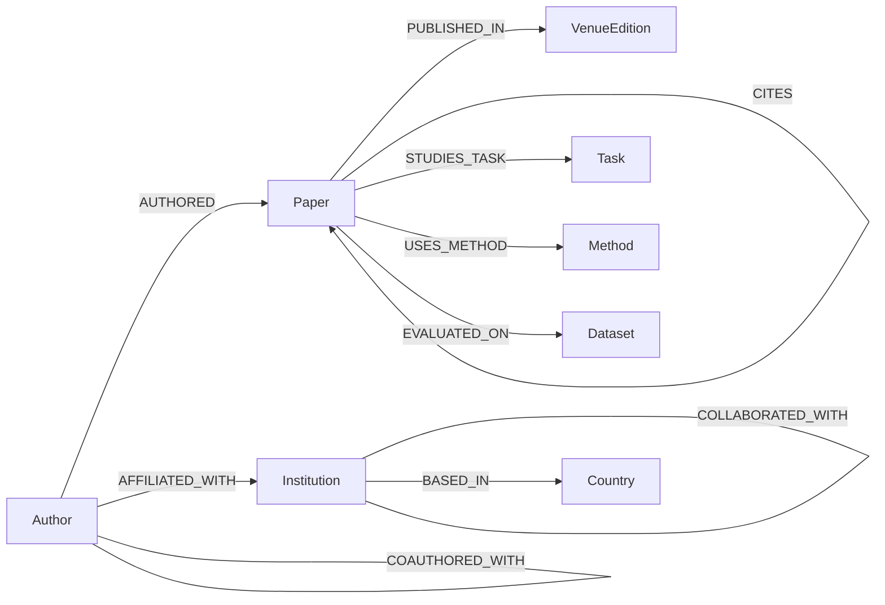
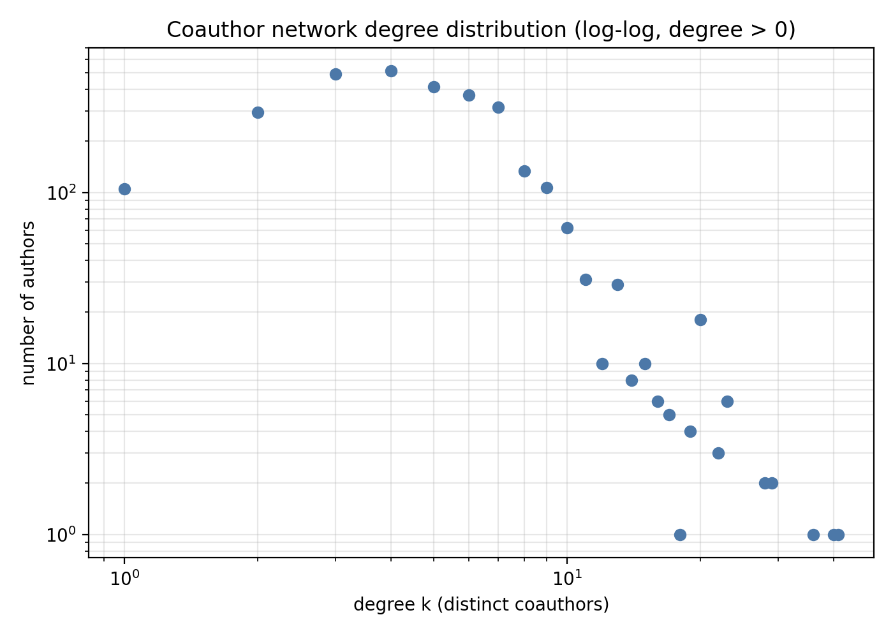
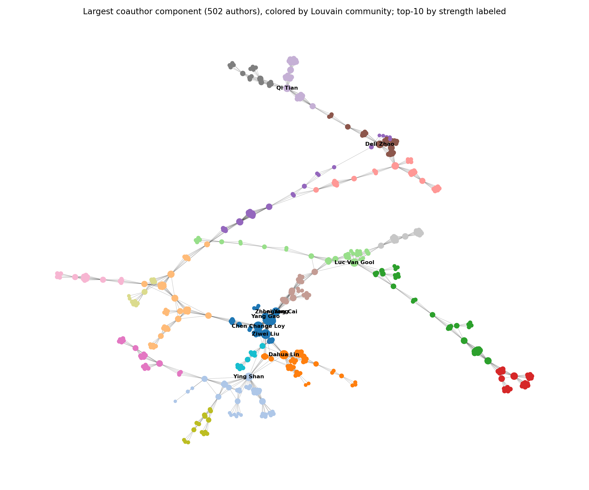
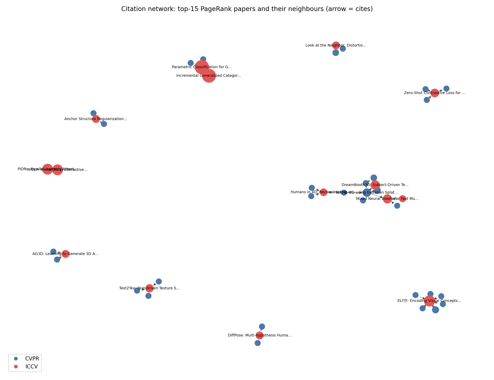
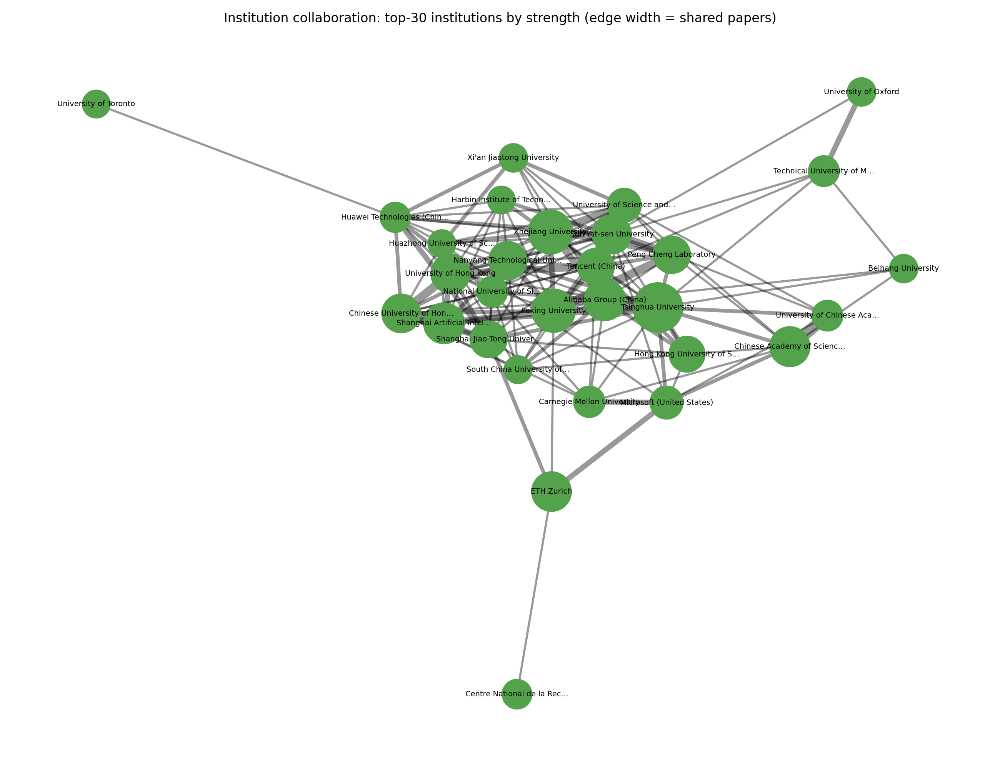
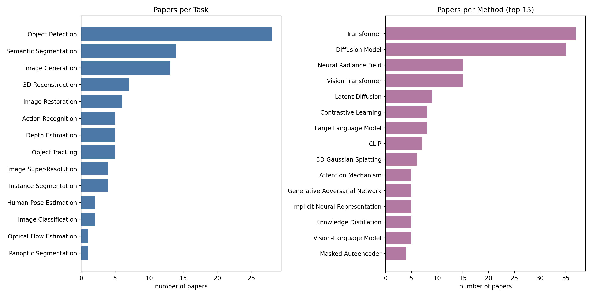
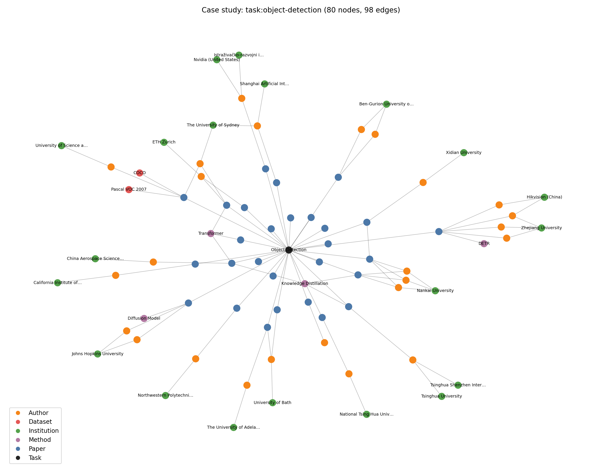

# B7 — Mô hình mạng, lưu trữ Neo4j, kết quả phân tích và case study

*Phần đóng góp của B cho báo cáo nhóm “Mạng lưới tác giả và tổ chức nghiên cứu về Computer Vision”, tương ứng mục 2 “Mô hình mạng” và mục 5 “Kết quả và case study” của dàn ý. Nguồn dữ liệu, tiền xử lý và trích xuất Task/Dataset đã được mô tả ở phần của A (xem A7) nên không nhắc lại. Mọi số liệu lấy từ snapshot graph `data/processed/mxh_cv_700/a8/graph` (snapshot_id `ffcb00e1…`) và từ `outputs/b6/metrics.json`, do `src.analysis` tính; tôi đã chạy lại với `--source csv` và các nhóm chỉ số coauthor, citation, institution, nlp, group_citation, case_study khớp hoàn toàn với bản đã lưu. Phần chấm chất lượng của người vẫn chờ kết quả và được đánh dấu rõ.*

## 2. Mô hình mạng

### 2.1. Nút, cạnh và cách đếm

Graph có **8 nhãn nút** và **10 loại quan hệ**, tổng cộng 4182 nút và 16979 cạnh duy nhất (số cạnh là số cặp khóa, không phải tổng trọng số). Tác giả và tổ chức là trọng tâm phân tích xã hội; Paper, VenueEdition, Task, Method, Dataset và Country cung cấp bằng chứng và bối cảnh. Số nút theo nhãn xem Bảng 6 của A7; ở đây chỉ nhắc lại các nhóm lớn: Author 2950, Paper 700, Institution 432, Country 42, Method 28, Task 14, Dataset 14, VenueEdition 2.

**Bảng 1. Mười loại quan hệ trong snapshot.** Đơn vị: cạnh duy nhất. Cột “Gốc” là trường `derivation` trong `edges.csv` (metadata: lấy từ bản ghi nguồn đã ghép; derived: suy ra theo quy tắc công bố; nlp: trích xuất từ title/abstract). Nguồn: `snapshot_manifest.json` và `edges.csv` của snapshot A8. Mọi cạnh đều có `evidence_ids` và `paper_ids` không rỗng (đã đếm lại trên 16979 cạnh).

| Quan hệ | Hướng | Gốc | Số cạnh | Ý nghĩa trọng số | Bằng chứng |
|---|---|---|---|---|---|
| AUTHORED | Author → Paper | metadata | 3282 | luôn 1 | lượt đứng tên trong byline CVF/OpenAlex |
| AFFILIATED_WITH | Author → Institution | metadata | 3237 | luôn 1 (kèm `paper_ids`) | affiliation của lượt đứng tên trên đúng bài |
| PUBLISHED_IN | Paper → VenueEdition | metadata | 700 | luôn 1 | trang chi tiết CVF của kỳ hội nghị |
| CITES | Paper → Paper | metadata | 97 | luôn 1 | `referenced_works` của bài nguồn, cả hai đầu là Paper core |
| BASED_IN | Institution → Country | metadata | 432 | luôn 1 | quốc gia của chính tổ chức theo metadata nguồn |
| COAUTHORED_WITH | Author — Author (vô hướng) | derived | 7771 | số Paper core riêng biệt có cả hai tác giả | các `paper_ids` hỗ trợ |
| COLLABORATED_WITH | Institution — Institution (vô hướng) | derived | 1140 | số bài chung có hai tác giả khác nhau gắn với hai tổ chức | các `paper_ids` hỗ trợ |
| STUDIES_TASK | Paper → Task | nlp | 97 | luôn 1 | câu/title nguyên văn, `rule_id`, offset (xem A7) |
| EVALUATED_ON | Paper → Dataset | nlp | 28 | luôn 1 | câu thí nghiệm trong abstract (xem A7) |
| USES_METHOD | Paper → Method | nlp | 195 | luôn 1 | title hoặc câu có vai trò “dùng/xây dựng” (xem 2.3) |

Quy tắc đếm cho hai quan hệ suy dẫn là phần dễ làm phồng quy mô nhất, nên được cố định như sau. Mỗi cặp Author (hoặc Institution) chỉ có **một** cạnh vô hướng, lưu theo thứ tự hai ID chuẩn hóa; không có self-loop. Trọng số là số Paper core khác nhau hỗ trợ cặp đó, nên một bài chỉ đóng góp 1 cho mỗi cặp dù có nhiều dòng affiliation. Với COAUTHORED_WITH, 7681 cạnh có trọng số 1, 85 cạnh có trọng số 2, 4 cạnh có trọng số 3 và 1 cạnh có trọng số 4. Một tác giả có hai affiliation không tự tạo cạnh COLLABORATED_WITH giữa hai tổ chức đó; cần hai tác giả khác nhau. COLLABORATED_WITH là hợp tác thể hiện qua công bố, không khẳng định có thỏa thuận chính thức.

**Core và reference.** `core` là Paper thuộc mẫu 700 bài (350 CVPR 2024 và 350 ICCV 2023). `reference` là bài được viện dẫn ngoài mẫu; snapshot này **không** nhập Paper reference nào (cả 700 Paper có `scope = core`). Hệ quả trực tiếp là mạng CITES chỉ chứa các cạnh core → core: một Work ID chỉ xuất hiện trong danh sách tham khảo thô không sinh node. Vì vậy phần trích dẫn bên dưới không nói gì về bài ngoài mẫu.

**Sơ đồ lược đồ.**



### 2.2. Sơ đồ định danh

ID có tiền tố theo nhãn để không đụng nhau giữa các lớp: Paper `cvf:<VENUE><năm>:<slug>` (kế thừa URL CVF), Author `author:openalex:<ID>`, Institution `institution:openalex:<ID>`, VenueEdition `venue:CVPR:2024:main`, Country `country:<mã ISO>` (ví dụ `country:CN`), Task/Method/Dataset theo slug từ điển (`task:object-detection`, `method:transformer`, `dataset:coco`). ID cạnh có dạng `edge:<sha256>`. Tên hiển thị không bao giờ là khóa. Country mô tả quốc gia của **tổ chức** nơi tác giả khai báo trên bài, không phải quốc tịch tác giả.

### 2.3. Quan hệ USES_METHOD (B5)

Từ điển `config/b5_method_dictionary.json` (phiên bản `b5-method-1.0.0`) có 30 Method, trong đó 28 Method xuất hiện ở ít nhất một cạnh accepted nên có node. Luật nằm trong `src/nlp/rules.py` với ba rule: `b5-method-title` (alias xuất hiện trong title thì nhận), `b5-method-use` (alias cách một từ chỉ vai trò “use/employ/adopt/build/…” không quá 12 token) và `b5-method-based` (alias đi trước “-based/-driven/-guided” trong câu có “we/our”). Kết quả là 195 cạnh, 178 bài có ít nhất một Method.

Các sai sót đã biết, chưa được đo chính thức. Rule title nhận Method ngay khi alias có trong title, nên có thể nhận nhầm các bài tấn công, benchmark hoặc giải thích mô hình mà Method chỉ là đối tượng bị phân tích. Rule “-based” có thể nhận cả Method được dùng làm baseline so sánh. Trong một lần kiểm tra thủ công không chính thức, tỷ lệ đúng theo tiêu chí chặt khoảng 80% và theo tiêu chí lỏng khoảng 97%. Đây là con số thăm dò, **chưa phải precision đã đo trên mẫu độc lập**; chờ audit (mục 6) mới có số cuối. Do đó mọi câu về “phương pháp nổi bật” bên dưới chỉ là mô tả những gì luật trích ra.

## 3. Lưu trữ trên Neo4j

Loader `src/graph/load_neo4j.py` đọc snapshot CSV, kiểm manifest (`graph_ready`, `project_id`, SHA-256 từng file, whitelist nhãn và thuộc tính, không có thuộc tính lồng JSON) rồi ghi vào Neo4j. Mỗi nhãn có ràng buộc duy nhất `(project_id, id)`. Việc dựng lại một project là **một giao dịch ghi duy nhất**: dừng nếu có quan hệ nối nút của project này với project khác; xóa đúng các quan hệ và nút trong whitelist của project; tạo nút theo nhãn rồi cạnh theo loại; đọc lại chính trong giao dịch, đếm theo nhãn/loại so với manifest và so **content hash** của dữ liệu trong DB với hash của CSV. Nếu một bước lệch, giao dịch bị hủy và DB giữ nguyên trạng thái cũ; tệp `last_import.json` chỉ ghi sau khi commit. Nhờ cách này, nạp lại cùng snapshot không làm tăng số nút hay cạnh.

Trạng thái hiện tại: DB chứa snapshot `ffcb00e1…`, đếm trong DB bằng manifest (4182 nút, 16979 cạnh), content hash `bed52069…` khớp hash tính từ CSV (`outputs/b_iccv2023/graph/last_import.json`). Hash này không gồm `snapshot_id` vì đó là thẻ nạp, không phải nội dung đồ thị. Bước phân tích B6 tự kiểm tra lại trước khi tính: khi `--source neo4j`, nó yêu cầu mọi nút trong DB mang đúng `snapshot_id` và hash nội dung bằng hash CSV, nếu không dừng; kết quả `neo4j_vs_csv = identical` và `manifest_match = true` ghi trong `metrics.json`. Số liệu bên dưới vì vậy gắn với một snapshot xác định, không phải “trạng thái DB lúc nào đó”.

## 5. Kết quả và case study

### 5.1. Cách tính

Các chỉ số tính bằng NetworkX trên graph dựng từ DB (có đối chiếu CSV). Đồng tác giả và hợp tác tổ chức là đồ thị vô hướng có trọng số; trích dẫn là đồ thị có hướng trên Paper. Louvain dùng `networkx.community.louvain_communities` với `weight = weight` và seed 42, chạy trên thành phần liên thông lớn nhất. PageRank dùng hệ số damping 0,85 trên đồ thị CITES có hướng. Bảng top đều sắp theo giá trị giảm dần và hòa theo ID nên tái lập được. Hình đặt ở `outputs/b6/figures`, bảng CSV ở `outputs/b6/tables`.

### 5.2. Mạng đồng tác giả

**Bảng 2. Chỉ số mạng đồng tác giả.** Đơn vị: nút là tác giả, cạnh là cặp tác giả duy nhất. Nguồn: `metrics.json → coauthor`, graph COAUTHORED_WITH trên 2950 tác giả.

| Chỉ số | Giá trị |
|---|---|
| Nút / cạnh | 2950 / 7771 |
| Mật độ | 0,0018 |
| Degree: trung bình / trung vị / p90 / lớn nhất | 5,27 / 5 / 9 / 41 |
| Strength: trung bình / lớn nhất | 5,33 / 45 |
| Tác giả cô lập (degree 0) | 4 |
| Số thành phần liên thông (có hơn 1 nút) | 416 (412) |
| Thành phần lớn nhất | 502 nút (17,0%), 1936 cạnh |
| Hệ số phân cụm trung bình (toàn mạng / thành phần lớn nhất) | 0,921 / 0,908 |
| Louvain trên thành phần lớn nhất | 19 cộng đồng, modularity 0,867 |



**Hình 1. Phân bố degree.** Đơn vị: số tác giả theo degree. Nguồn: `degree_distribution` trong `metrics.json`. Phần lớn tác giả có degree từ 3 đến 7 (đỉnh ở degree 4 với 514 người), đuôi dài chỉ gồm vài tác giả có degree trên 30. Dạng này khớp với việc mỗi bài tạo một nhóm tác giả đầy đủ liên kết, nên số cộng tác của một người chủ yếu bằng số đồng tác giả trên các bài mà họ có trong mẫu. Hệ số phân cụm gần 0,92 cũng là hệ quả của cấu trúc nhóm theo bài, không nên đọc thành “cộng đồng gắn bó chặt” theo nghĩa xã hội học.

Mạng rất phân mảnh: thành phần lớn nhất chỉ chiếm 17,0% tác giả; 415 thành phần còn lại gồm 411 nhóm có hơn một nút, nhỏ hơn nhiều, và 4 tác giả cô lập. Điều này phản ánh thiết kế mẫu (700 bài cố định, không lấy theo láng giềng cộng tác), không phải đặc tính của cả cộng đồng CV. Louvain tách thành phần lớn nhất thành 19 cộng đồng, kích thước từ 41 xuống 11 nút, modularity 0,867. Giá trị cao vì thành phần được nối bởi các nhóm bài tương đối riêng, còn cộng đồng thuật toán tìm ra không mặc định là phòng thí nghiệm chính thức. Kết quả Louvain phụ thuộc phiên bản thư viện và seed (mục 7).



**Hình 2. Thành phần liên thông lớn nhất (502 tác giả), tô màu theo cộng đồng Louvain.** Đơn vị: nút là tác giả, cạnh là COAUTHORED_WITH; seed 42. Nguồn: `figures.py`, từ cùng dữ liệu Bảng 2.

Năm tác giả có degree cao nhất là Ziwei Liu (41 đồng tác giả khác nhau, strength 45, 5 bài trong mẫu), Chen Change Loy (40, 44, 5 bài), Dahua Lin (36, 39, 7 bài), Luc Van Gool (29, 34, 8 bài) và Ying Shan (29, 31, 5 bài). Strength lớn hơn degree vì có cặp cùng đứng tên nhiều hơn một bài. Danh sách này nói về hợp tác **trong 700 bài của mẫu**, không phải xếp hạng ảnh hưởng của tác giả; một số người có degree cao (ví dụ Lei Yang, Zhongang Cai với 2 bài, degree 28) chỉ do đứng tên trên các bài có nhiều tác giả.

### 5.3. Mạng trích dẫn

**Bảng 3. Cạnh CITES theo cặp hội nghị.** Đơn vị: cạnh Paper → Paper. Nguồn: `metrics.json → citation`.

| Bài trích dẫn → bài được trích dẫn | Số cạnh |
|---|---|
| CVPR 2024 → ICCV 2023 | 81 |
| CVPR 2024 → CVPR 2024 | 9 |
| ICCV 2023 → ICCV 2023 | 7 |
| ICCV 2023 → CVPR 2024 | 0 |
| Tổng | 97 |

Việc không có cạnh ICCV 2023 → CVPR 2024 được giải thích bằng thời điểm: ICCV 2023 công bố trước, bài của kỳ này không thể tham khảo bài CVPR 2024. Hướng CVPR → ICCV chiếm 81/97 cạnh. Mạng CITES rất thưa: 610 thành phần liên thông yếu, chỉ 48 thành phần có hơn một bài, thành phần lớn nhất gồm 20 bài. 90,3% bài không được bài nào trong mẫu trích dẫn, 88,6% không trích bài nào trong mẫu và **80,3% bài không có cạnh trích dẫn nào** trong mẫu. Do đó không thể kết luận rộng về cấu trúc trích dẫn từ mạng này; nó chỉ cho thấy các điểm tập trung cục bộ.



**Hình 3. Mạng CITES, kích thước nút theo PageRank.** Đơn vị: nút là Paper, cạnh có hướng; PageRank damping 0,85. Nguồn: `metrics.json → citation` và `tables/citation_top_*.csv`.

Về in-degree, bài nổi nhất là ELITE (ICCV 2023, tạo ảnh tùy biến từ văn bản) được 6 bài trong mẫu trích dẫn; tiếp theo là “Text-to-3D using Gaussian Splatting” (CVPR 2024) với 4, rồi nhiều bài ICCV 2023 với 3 như Text2Tex, Humans in 4D, DreamBooth3D. Về PageRank, hai bài đầu là “Parametric Classification for Generalized Category Discovery” (0,0154) và “Incremental Generalized Category Discovery” (0,0142): chúng không có in-degree lớn nhất mà được nâng bởi liên kết giữa hai bài trong cùng một cụm nhỏ. Với mạng thưa thế này, PageRank và in-degree chỉ nên đọc như mô tả mẫu. Hai chỉ số này không thay cho số trích dẫn toàn cục (`cited_by_count`), vốn không được dùng để tạo cạnh.

### 5.4. Tổ chức và quốc gia

Mạng COLLABORATED_WITH có 432 tổ chức và 1140 cạnh; 26 tổ chức cô lập. Quốc gia của tổ chức lấy qua BASED_IN, mỗi bài gán tập quốc gia của các tổ chức mà tác giả của chính bài đó khai báo (qua `paper_ids` trên AFFILIATED_WITH). 666/700 bài có ít nhất một quốc gia; **34 bài không có**, và các bài đó bị loại khỏi mọi thống kê theo quốc gia.

**Bảng 4. Tổ chức và quốc gia nổi bật.** Đơn vị: strength là tổng trọng số cạnh (số bài chung) của tổ chức; “số bài” của quốc gia là số bài có ít nhất một tổ chức ở nước đó. Nguồn: `tables/institution_top_strength.csv`, `country_summary.csv`, `metrics.json → institution`.

| Tổ chức (nước) | Degree | Strength | | Quốc gia | Số tổ chức | Số bài |
|---|---|---|---|---|---|---|
| Tsinghua University (CN) | 48 | 69 | | CN | 111 | 342 |
| Zhejiang University (CN) | 38 | 54 | | US | 98 | 206 |
| Peking University (CN) | 32 | 52 | | HK | 7 | 60 |
| Alibaba Group (CN) | 29 | 47 | | KR | 24 | 53 |
| Shanghai AI Laboratory (CN) | 30 | 46 | | SG | 8 | 49 |
| Chinese Academy of Sciences (CN) | 24 | 44 | | GB | 19 | 47 |



**Hình 4. Mạng hợp tác của 30 tổ chức có strength cao nhất.** Đơn vị: nút là tổ chức, độ dày cạnh là số bài chung. Nguồn: `figures.py`, `tables/institution_top_strength.csv`. Một số cặp cạnh mạnh nhất là quan hệ giữa các đơn vị cùng hệ thống (Chinese Academy of Sciences – Institute of Automation: 8 bài; CAS – University of Chinese Academy of Sciences: 7), nên không phải hợp tác độc lập theo nghĩa thông thường.

Tính theo trọng số cạnh tổ chức quy về cặp quốc gia, hợp tác trong cùng một nước có tổng trọng số 686 và giữa hai nước khác nhau là 664, trải trên 111 cặp quốc gia khác nhau. Các cặp quốc tế đứng đầu là **CN–US 99, CN–HK 83, CN–SG 46**, tiếp theo CN–AU 30, HK–US 24, CN–GB 19. Hợp tác Trung Quốc đại lục với Hồng Kông, Singapore và Mỹ vì vậy chiếm phần lớn hợp tác quốc tế trong mẫu. Lưu ý quốc gia là của tổ chức; tác giả có thể mang quốc tịch khác, và một cặp quốc gia có thể bị đếm lặp qua nhiều cặp tổ chức khác nhau trên cùng một bài.

### 5.5. Trích dẫn giữa các nhóm quốc gia

Từ 97 cạnh CITES, **95 cạnh gán được cho nhóm quốc gia** và 2 cạnh bị loại vì một đầu không có quốc gia. Quy tắc gán: tập quốc gia của bài như ở 5.4. Mỗi cạnh CITES đóng góp tổng trọng số 1, chia đều cho mọi cặp (quốc gia nguồn × quốc gia đích), nên một bài nhiều nước không nhân số lần trích dẫn; tổng ma trận đúng bằng 95,0 và có 84 ô khác không. Đây là **phép tổng hợp phân tích** trên các cạnh đã có, không thêm quan hệ thứ 11 vào graph, và không khẳng định từng tác giả chủ động trích dẫn nhau.

**Bảng 5. Trích dẫn giữa nhóm quốc gia (6 ô lớn nhất).** Đơn vị: trọng số phân đoạn (tổng 95,0). Hàng là nước của bài trích dẫn, cột là nước của bài được trích dẫn. Nguồn: `tables/group_citation_country_matrix.csv`.

| Từ | Đến | Trọng số |
|---|---|---|
| CN | CN | 19,28 |
| US | US | 7,17 |
| CN | HK | 5,36 |
| CN | US | 5,36 |
| DE | CN | 4,33 |
| US | CN | 3,42 |

Trọng số nội bộ một nước là 30,78 (32,4%) và giữa hai nước khác nhau là 64,22 (67,6%). Tỷ lệ “quốc tế” này bị khuếch đại một phần bởi cách chia phân đoạn khi bài có nhiều nước, nên chỉ so sánh định tính. Nhóm CN có xu hướng tự trích dẫn nhiều nhất (19,28), kế đến là US với US (7,17); phần còn lại phân tán trên nhiều cặp. Với 95 cạnh, ma trận chỉ cho thấy xu hướng, không đủ để so sánh thống kê giữa các nước nhỏ.

### 5.6. Phân bố Task và Method



**Hình 5. Số bài theo Task và theo Method.** Đơn vị: bài có cạnh STUDIES_TASK / USES_METHOD tới nút đó. Nguồn: `tables/nlp_tasks_papers.csv`, `nlp_methods_papers.csv`. Chỉ 95 bài có Task, 178 bài có Method và 21 bài có Dataset; tổng 267 bài có ít nhất một cạnh NLP. Con số thấp là hệ quả của từ điển hữu hạn và luật bảo thủ (xem A7), không có nghĩa 433 bài còn lại không thuộc Task nào.

Về Task, Object Detection dẫn đầu với 28 bài, theo sau là Semantic Segmentation (14) và Image Generation (13), rồi 3D Reconstruction (7) và Image Restoration (6). Về Method, Transformer (37 bài) và Diffusion Model (35) đứng đầu, sau đó Neural Radiance Field và Vision Transformer (15 bài mỗi loại), Latent Diffusion (9), Contrastive Learning và Large Language Model (8 mỗi loại). Dataset được nhận nhiều nhất là nuScenes (6 bài), COCO và KITTI (3 bài mỗi loại). Với các hạn chế của luật Method ở 2.3, thứ hạng Method là gần đúng và chưa được audit.

### 5.7. Case study: Object Detection

Task được chọn theo quy tắc cố định trong mã: dùng `task:object-detection` nếu có ít nhất 10 bài, nếu không dùng Task có nhiều bài nhất. Trường hợp này có 28 bài (20 ICCV, 8 CVPR) nên điều kiện thỏa. Mạng con giữ nút Task, toàn bộ 28 bài của nó, các Method/Dataset gắn với các bài đó, rồi thêm tác giả theo số bài trong tập con (hòa theo ID) cùng các tổ chức liên quan đến các bài đó, dừng khi sắp vượt 80 nút. Kết quả là **80 nút** (28 Paper, 25 Author, 20 Institution, 4 Method, 2 Dataset, 1 Task) và **98 cạnh** (31 AUTHORED, 28 AFFILIATED_WITH, 28 STUDIES_TASK, 8 USES_METHOD, 2 EVALUATED_ON, 1 CITES).



**Hình 6. Mạng con quanh Task Object Detection.** Đơn vị: nút (Paper, Author, Institution, Method, Dataset, Task) và cạnh có nhãn quan hệ. Nguồn: `outputs/b6/case_study/{nodes,edges,papers,citations_inside}.csv`. Tác giả chỉ là 25 người đầu theo quy tắc cắt nút, không phải toàn bộ tác giả của 28 bài.

Các Method xuất hiện là DETR, Diffusion Model, Knowledge Distillation và Transformer (8 cạnh), còn Dataset là COCO và Pascal VOC 2007 (2 cạnh). Hai Method có nhiều bài nhất trong nhóm là Knowledge Distillation và Transformer với 3 bài mỗi Method. Các tổ chức trong mạng con gồm Tsinghua University, Zhejiang University, ETH Zurich, Nvidia, Shanghai AI Laboratory, Hikvision, University of Science and Technology of China, Caltech, Johns Hopkins University, The University of Sydney và nhiều nơi khác (20 tổ chức); không tác giả nào trong 25 người được giữ có quá 2 bài trong tập 28 bài (Jiajun Deng, Zhaohui Zheng, Da Chen, Qibin Hou, Fisher Yu mỗi người 2 bài), nên không có nhóm tác giả hợp tác dày quanh Task này.

Điểm quan trọng là cấu trúc **chỉ có một cạnh trích dẫn nội bộ** (bài CVPR 2024 về SAR Object Detection trích bài ICCV 2023 về Large Selective Kernel Network cho Remote Sensing). Phần còn lại là các bài riêng lẻ cùng nối vào nút Task, tức hình sao quanh Task Object Detection. Mạng con này vì vậy cho thấy ai làm gì với Object Detection, chứ không cho thấy các nhóm hợp tác hay trích dẫn lẫn nhau. Nhận định đó phù hợp với mạng CITES thưa ở 5.3. Chỉ 8 cạnh Method và 2 cạnh Dataset cũng cho thấy phần lớn bài chưa có Method/Dataset nhận được bằng luật, chứ không chứng minh các bài không dùng chúng.

### 5.8. Truy vấn Cypher minh họa

Repo có các truy vấn `queries/b6_*.cypher` chạy được trên DB đã nạp. Hai ví dụ ngắn:

```cypher
MATCH (a:Paper {project_id: 'mxh_cv_700'})-[:CITES]->(b:Paper)
RETURN a.conference AS citing_conference, b.conference AS cited_conference, count(*) AS citations
ORDER BY citing_conference, cited_conference;
```

Trả về 3 dòng (CVPR→CVPR 9, CVPR→ICCV 81, ICCV→ICCV 7), khớp Bảng 3.

```cypher
MATCH (:Paper {project_id: 'mxh_cv_700'})-[c:CITES]->(p:Paper)
RETURN p.name AS title, p.conference AS conference, count(c) AS cited_by_core
ORDER BY cited_by_core DESC, title
LIMIT 15;
```

Trả về 15 dòng (đầu bảng là ELITE với 6). Số dòng của năm truy vấn trong `metrics.json → cypher_demo`: `b6_case_study` 28, `b6_top_cited` 15, `b6_method_usage` 28, `b6_cross_conference_citations` 3, `b6_country_collaboration` 15; các số khớp kỳ vọng (28 bài của case study, 28 Method trong graph, 3 cặp hội nghị, hai truy vấn LIMIT 15).

### 5.9. Trả lời các câu hỏi phân tích

**Ai hợp tác với ai?** Trong mẫu, hợp tác tác giả phân mảnh thành 416 thành phần; thành phần lớn nhất chỉ có 502 tác giả (17,0%), tách thành 19 cộng đồng Louvain. Các tác giả nối nhiều nhất là Ziwei Liu, Chen Change Loy, Dahua Lin, Luc Van Gool và Ying Shan. Ở cấp tổ chức, Tsinghua, Zhejiang, Peking, Alibaba và Shanghai AI Laboratory có strength cao nhất; hợp tác quốc tế đậm nhất là CN–US (99), CN–HK (83) và CN–SG (46).

**Nhóm nào trích dẫn nhóm nào?** Chỉ có 97 cạnh CITES, trong đó 81 đi từ CVPR 2024 sang ICCV 2023 và không có chiều ngược lại. Với 95 cạnh gán được quốc gia, CN→CN chiếm 19,28 và US→US 7,17; trích dẫn giữa hai nước khác nhau chiếm 64,22 trên 95,0 trọng số. Số cạnh nhỏ nên chỉ nêu xu hướng.

**Task và Method nào chiếm ưu thế?** Object Detection (28 bài), Semantic Segmentation (14) và Image Generation (13) là ba Task nhiều nhất; Transformer (37) và Diffusion Model (35) là hai Method nhiều nhất. Các số này chỉ là bài mà từ điển và luật trích được, với 95/178 bài có Task/Method; chúng chưa phải tần suất thật của chủ đề trong mẫu.

## 6. Kiểm tra chất lượng (audit A8)

Mục này mô tả thiết kế; **chưa có kết quả chấm của người, nên không có precision nào được công bố.** Mẫu audit lấy từ snapshot A8 bằng seed cố định 20261103 trong `config/a8_audit.json`, gồm ba phần: 100 cạnh primary (10 cạnh mỗi loại trong 10 loại quan hệ, phân tầng theo loại; chia mỗi người chấm 50 cạnh); 20 cạnh đọc chéo (2 cạnh mỗi loại, người còn lại chấm); và 50 nút có nguy cơ trùng tên/affiliation. File mẫu nằm ở `outputs/a8/audit/a6_edge_audit_sample.csv` (120 dòng) và `a6_node_audit_sample.csv`. Một cạnh chỉ được tính là đúng khi đúng hai thực thể, quan hệ, hướng, phạm vi và có nguồn hỗ trợ. Cạnh `unverifiable` được tính là chưa đúng trong precision bảo thủ; cạnh `pending_review` bị loại khỏi mẫu số. Tỷ lệ thu được là tỷ lệ trên mẫu phân tầng, không phải ước lượng cho cả graph nếu chưa nhân trọng số theo số cạnh mỗi loại. Mẫu 100 cạnh là phép phát hiện lỗi trước hạn, không phải kiểm định chính thức.

Trạng thái chấm ở thời điểm viết là 0/100 primary, 0/20 đọc chéo, 0/50 nút đã chấm. Bảng dưới được để trống có chủ đích.

**Bảng 6. Kết quả chấm của người (chờ điền).** Đơn vị: số cạnh trong mẫu.

| Loại quan hệ | Đã chấm / 10 | Đúng | Sai | Unverifiable | Precision bảo thủ |
|---|---|---|---|---|---|
| (10 loại quan hệ) | <!-- CHỜ KẾT QUẢ CHẤM --> | <!-- CHỜ KẾT QUẢ CHẤM --> | <!-- CHỜ KẾT QUẢ CHẤM --> | <!-- CHỜ KẾT QUẢ CHẤM --> | <!-- CHỜ KẾT QUẢ CHẤM --> |

Đọc chéo: <!-- CHỜ KẾT QUẢ CHẤM --> trên 20 cạnh; bất đồng: <!-- CHỜ KẾT QUẢ CHẤM -->. Nút rủi ro: <!-- CHỜ KẾT QUẢ CHẤM --> trên 50 nút. Kiểm tra máy của A6 trên snapshot (A7, Bảng 7) báo 0 lỗi tự động được xác nhận trong phạm vi các check, nhưng đó không phải phép đo độ chính xác ngữ nghĩa.

## 7. Hạn chế

- **Mạng CITES rất thưa.** 97 cạnh trên 700 bài; 80,3% bài không có trích dẫn nào trong mẫu. Mọi suy luận về trích dẫn, PageRank và trích dẫn giữa nhóm chỉ mô tả mẫu này.
- **Thiếu quốc gia.** 34/700 bài không suy ra được quốc gia do thiếu affiliation đã resolve; chúng bị loại khỏi thống kê quốc gia và khỏi 2 trên 97 cạnh CITES. Quốc gia của tổ chức không phải quốc tịch tác giả.
- **Mẫu không đại diện.** 700 bài cố định (hai kỳ hội nghị), nên mật độ thấp và nhiều thành phần nhỏ là hệ quả của cách chọn mẫu.
- **Louvain.** Kết quả phụ thuộc phiên bản NetworkX và seed (42). Số cộng đồng và modularity (19; 0,867) có thể đổi khi nâng phiên bản thư viện; chỉ so sánh khi cố định phiên bản.
- **Method (B5).** Rule title có thể nhận nhầm bài tấn công/benchmark/giải thích; rule “-based” có thể nhận baseline. Tỷ lệ đúng không chính thức khoảng 80% (chặt) và 97% (lỏng) chỉ là con số thăm dò, chờ audit; Task/Dataset cũng giới hạn bởi từ điển hữu hạn (xem A7).
- **Cảnh báo bằng chứng CITES.** A6 báo 97 cạnh CITES có `evidence` chưa chỉ chính xác vào trường danh sách tham khảo. Đây là cảnh báo độ cụ thể của bằng chứng, chưa phải xác nhận 97 cạnh sai; raw và canonical đã tìm thấy quan hệ.
- **Cộng đồng và cạnh suy dẫn.** Cộng đồng Louvain không phải lab chính thức; hợp tác tổ chức có thể phản ánh cùng một hệ thống (ví dụ các viện thuộc CAS); số tác giả chưa resolve ID có thể làm lệch mạng về phía các tác giả OpenAlex nhận diện tốt.

## 8. Tái lập

Từ thư mục `FinalTerm`, dùng môi trường `.venv-a4`. Nạp snapshot vào Neo4j (cần `.env` hoặc biến môi trường cho kết nối; không ghi mật khẩu vào repo):

```bash
.venv-a4/bin/python -B -X utf8 -m src.graph.load_neo4j --snapshot data/processed/mxh_cv_700/a8/graph
```

Chạy phân tích từ DB (kèm đếm kết quả Cypher demo), hoặc offline từ CSV (không chạy Cypher demo, không cần Neo4j):

```bash
.venv-a4/bin/python -B -X utf8 -m src.analysis
.venv-a4/bin/python -B -X utf8 -m src.analysis --source csv
```

Kiểm thử:

```bash
.venv-a4/bin/python -B -X utf8 -m unittest src.analysis.test_analysis
```

Đầu ra: `outputs/b6/metrics.json`, `outputs/b6/tables/*.csv`, `outputs/b6/case_study/*.csv` và sáu hình `outputs/b6/figures/{a..f}_*.png`. Tùy chọn `--no-figures` bỏ qua vẽ hình và `--out` đổi thư mục xuất. Với `--source neo4j`, mã dừng nếu DB không chứa đúng snapshot `ffcb00e1…` hoặc hash nội dung khác CSV.
